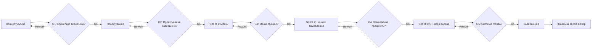

# Життєвий цикл проєкту EatUp

## 5.1. Обрана модель життєвого циклу

**Модель:** Scrum  
**Тип:** адаптивна (Agile)

Scrum підходить для EatUp, оскільки проєкт є невеликим навчальним вебзастосунком із низьким рівнем невизначеності вимог. Основна функціональність включає перегляд меню, додавання страв до кошика, оформлення замовлення та отримання QR-коду.

Робота короткими спринтами дозволяє поступово реалізовувати функції, тестувати результати та виправляти помилки. Такий підхід підходить для студентської команди з трьох осіб та обмеженого часу розробки.

---

## 5.2. Фази життєвого циклу

| № | Назва фази | Мета фази | Тривалість (тижнів) | Ключові роботи | Deliverables | Відповідальний |
|---|---|---|---|---|---|---|
| 1 | **Концептуальна** | Визначити цілі та основні функції проєкту | 1 | Аналіз проблеми; визначення цільової аудиторії; формування вимог | Опис проєкту; перелік основних функцій | Team Lead / Analyst |
| 2 | **Проєктування** | Розробити структуру та дизайн вебзастосунку | 1 | Створення макетів сторінок; визначення структури даних; вибір технологій | Макети інтерфейсу; структура застосунку | Analyst / Developer |
| 3 | **Розробка — Sprint 1** | Реалізувати меню їдальні | 2 | Створення головної сторінки; відображення страв, цін та описів; адаптація інтерфейсу | Робоча сторінка меню | Developer |
| 4 | **Розробка — Sprint 2** | Реалізувати оформлення замовлень | 2 | Створення кошика; додавання та видалення страв; підрахунок вартості; підтвердження замовлення | Кошик; оформлення замовлення | Developer / Analyst |
| 5 | **Розробка — Sprint 3** | Додати QR-код та підтвердження видачі | 2 | Генерація QR-коду замовлення; створення простої сторінки працівника; зміна статусу замовлення | QR-код; сторінка перегляду та підтвердження замовлень | Developer |
| 6 | **Завершення** | Перевірити роботу застосунку та підготувати демонстрацію | 1 | Тестування; виправлення помилок; підготовка документації | Фінальна версія EatUp; документація; демонстрація | Team Lead / Analyst / Developer |

**Загальна тривалість проєкту:** 9 тижнів.

---

## 5.3. Ворота між фазами

| Ворота | Між фазами | Критерії переходу | Можливі рішення |
|---|---|---|---|
| **G1** | Концептуальна → Проєктування | Визначено цілі, цільову аудиторію та основні функції | Go / Rework / Kill |
| **G2** | Проєктування → Sprint 1 | Підготовлено макети сторінок та визначено технології | Go / Rework / Kill |
| **G3** | Sprint 1 → Sprint 2 | Меню відображається правильно, страви та ціни доступні користувачу | Go / Rework / Kill |
| **G4** | Sprint 2 → Sprint 3 | Кошик працює, загальна вартість розраховується, замовлення оформлюється | Go / Rework / Kill |
| **G5** | Sprint 3 → Завершення | QR-код генерується, працівник може знайти та підтвердити замовлення | Go / Rework / Kill |

**Go** — перехід до наступної фази.  
**Rework** — повернення на доопрацювання.  
**Kill** — припинення проєкту.

---

## 5.4. Візуалізація життєвого циклу

---

## 5.5. Обґрунтування вибору моделі

EatUp є невеликим навчальним вебзастосунком із чітко визначеним набором функцій. Для його розробки обрано Scrum, оскільки ця модель дозволяє розділити роботу на короткі спринти та поступово створювати готовий продукт.

Як альтернативу можна було використати **Waterfall**, але ця модель менш гнучка при необхідності змінювати вимоги. Scrum дозволяє перевіряти результати після кожного етапу та своєчасно виправляти помилки.

Під час першого спринту команда створює меню їдальні. Другий спринт передбачає реалізацію кошика та оформлення замовлень. У третьому спринті додається генерація QR-кодів та проста сторінка для підтвердження видачі страв.

Основними ризиками є обмежений час розробки, помилки під час оформлення замовлень та генерації QR-кодів. Для їх мінімізації передбачається використання готових бібліотек і тестування кожної функції.

Використання Scrum дозволить команді послідовно реалізувати основні можливості EatUp без складних інтеграцій та зайвих технічних рішень.
