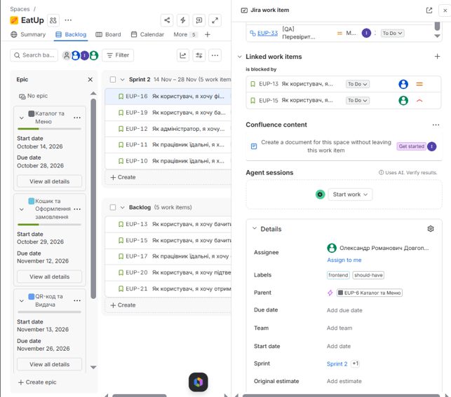
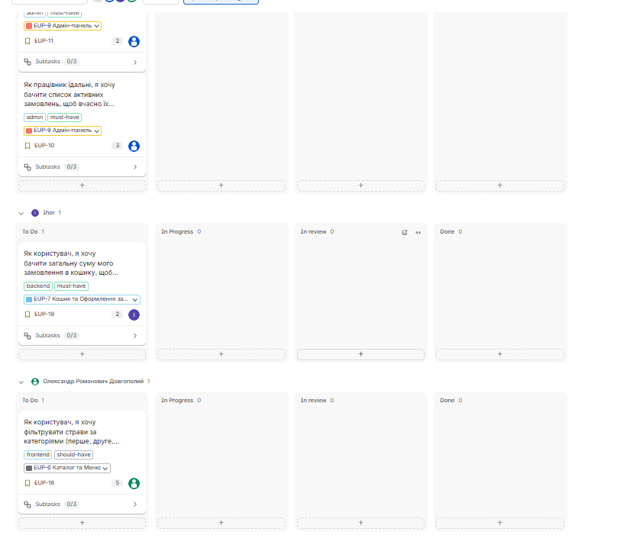
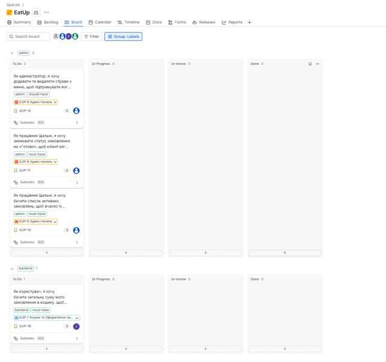
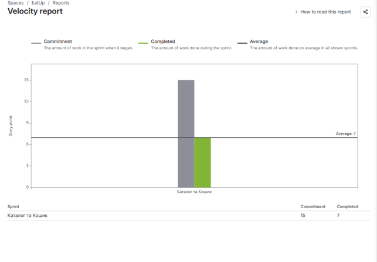
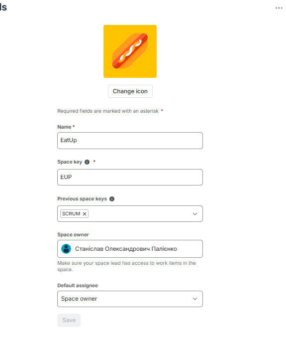
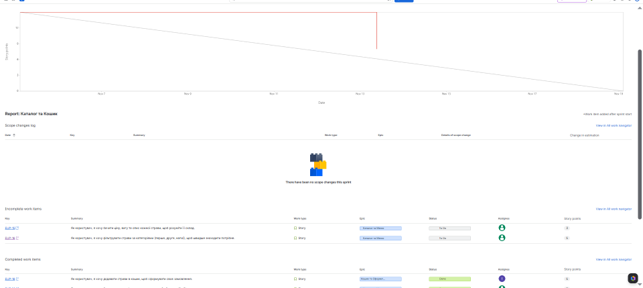

# Управління ресурсами та зонами відповідальності — EatUp (EUP)

* **Проєкт:** EatUp (`EUP`) — https://eatup.atlassian.net
* **Тип проєкту:** Team-managed Scrum (Private access)
* **Дата актуалізації даних:** 23.11.2026
* **Завершений спринт:** «Каталог та Кошик» (Sprint 1: 05.11.2026 – 19.11.2026)
* **Активний спринт:** Sprint 2 (14.11.2026 – 28.11.2026)

---

## 2.1. Склад команди

| Учасник | Ролі в проекті | Доступність (FTE) | Годин на тиждень |
| :--- | :--- | :---: | :---: |
| Станіслав Палієнко | PM / PO + Admin / QR Lead (Administrator) | 0.35 | 14 |
| Олександр Довгополий | Frontend + Analyst (Member) | 0.30 | 12 |
| Ігор Труш | Backend + QA (Member) | 0.30 | 12 |
| **Разом по команді** | — | **0.95** | **38** |

---

## 2.2. Capacity на спринт

| Параметр | Значення | Коментар |
| :--- | :---: | :--- |
| Тривалість спринту | 2 тижні | Стандартна ітерація проєкту EatUp (14 календарних днів) |
| Σ годин команди на спринт | 76 год | З таблиці 2.1: 38 год/тиждень × 2 тижні |
| Коефіцієнт на непродуктивний час (мітинги, рев'ю) | −20% (−15.2 год) | Планування, дейлі, код-рев'ю та синхронізація |
| Ефективна Capacity | 60.8 год | 76 год × 0.8 = 60.8 год чистого часу розробки |
| Velocity (факт, Sprint 1 «Каталог та Кошик») | 7 SP | З *Velocity report* (заплановано 15 SP, виконано 7 SP) |
| Годин на 1 SP | 8.69 год/SP | Capacity ÷ Velocity = 60.8 ÷ 7 ≈ 8.69 год/SP |
| Плановий обсяг наступного спринту | 10 SP | Консервативний прогноз з урахуванням фактичної Velocity (7 SP) та завершення адаптації команди |

---

## 2.3. Skills Matrix

Оцінка навичок: `0` — немає, `1` — базовий, `2` — впевнений, `3` — сильний.

| Навичка | Станіслав Палієнко | Олександр Довгополий | Ігор Труш | Потрібний рівень | Ризик |
| :--- | :---: | :---: | :---: | :---: | :--- |
| React / Frontend | 1 | 2 | 1 | ≥2 | Середній (один профільний виконавець рівня ≥2) |
| Node.js / Backend | 2 | 1 | 2 | ≥2 | Низький (взаємозамінність Станіслава та Ігоря) |
| Бази даних | 2 | 1 | 2 | ≥2 | Низький (покрито двома учасниками) |
| Тестування (QA) | 1 | 1 | 2 | ≥1 | Низький (усі учасники володіють базовим QA) |
| DevOps / Деплой | 2 | 0 | 1 | ≥1 | Середній (основна компетенція у Станіслава) |
| Дизайн / Figma | 1 | 2 | 1 | ≥1 | Низький (покрито Олександром на рівні 2) |
| Git / Code Review | 2 | 2 | 2 | ≥2 | Низький (уся команда впевнено працює з Git) |

---

## 2.4. Аналіз Skills Matrix

| Питання | Відповідь |
| :--- | :--- |
| Яка навичка покрита лише однією людиною? | **React / Frontend** на цільовому рівні `≥2` покрита лише Олександром Довгополими (рівень 2; у Станіслава та Ігоря — базовий рівень 1). Також **DevOps / Деплой** на рівні 2 та **Дизайн / Figma** на рівні 2 закріплені за одним фахівцем кожна. |
| Який Bus Factor у критичних зонах? | У зонах **Backend** та **Бази даних** `Bus Factor = 2` (Станіслав та Ігор можуть підстрахувати один одного). У зонах **Frontend** та **DevOps / Деплой** `Bus Factor = 1` — при вибутті профільного виконавця темп розробки UI або релізу суттєво сповільниться. |
| Яка навичка потрібна, але відсутня/слабка? | Поглиблений **React / Frontend** для роботи з динамічним станом кошика та автооновленням статусів замовлення в реальному часі (у двох із трьох учасників оцінка `1`), а також налаштування CI/CD-пайплайнів у **DevOps** (у Олександра оцінка `0`). |
| План закриття розриву (хто що вчить, до якого спринту) | 1. **Станіслав та Ігор** до початку **Sprint 3** проходять спільне code review фронтенд-компонентів Олександра (`EUP-15`, `EUP-16`) і підтягують React/верстку з рівня `1` до `2` на підзадачах `[FE]`. 2. **Ігор** до кінця **Sprint 2** бере участь у налаштуванні тестового середовища деплою разом зі Станіславом, щоб підняти DevOps з `1` до `2`. |

---

## 2.5. Зони відповідальності (Labels)

У зв'язку з тим, що в team-managed проєктах Jira відсутні системні `Components`, технічні зони закріплені через обов'язкові зонні `Labels` (рівно одна мітка зони на кожну Story, Epic та Subtask; процесні пріоритетні мітки `must-have` / `should-have` збережені).

| Label | Area Lead | К-сть задач | Що входить |
| :--- | :--- | :---: | :--- |
| `admin` | Станіслав Палієнко | 13 | Адмін-панель їдальні: перегляд списку активних замовлень, зміна статусів, CRUD-операції меню (`EUP-9` – `EUP-12`, підзадачі `EUP-22` – `EUP-30`) |
| `backend` | Ігор Труш | 7 | Кошик, розрахунок вартості та оформлення замовлення, сервісна логіка й API (`EUP-7`, `EUP-18`, `EUP-19`, `EUP-20`, підзадачі `EUP-34` – `EUP-36`) |
| `frontend` | Олександр Довгополий | 7 | Каталог страв, фільтрація за категоріями, картки страв із ціною, вагою та описом (`EUP-6`, `EUP-14`, `EUP-15`, `EUP-16`, підзадачі `EUP-31` – `EUP-33`) |
| `qr` | Станіслав Палієнко | 4 | Генерація QR-коду замовлення, сканування працівником їдальні та трекінг статусу клієнтом (`EUP-8`, `EUP-13`, `EUP-17`, `EUP-21`) |

> **Перевірка цілісності JQL:** Після присвоєння зонних міток усім актуальним Epics, Stories, Subtasks та видалення/позначення двох початкових тестових записів ініціалізації проєкту (`EUP-3` *Task 3*, `EUP-4` *Subtask 2.1*) фільтр `project = EUP AND labels is EMPTY` повертає **0 задач**.

---

## 2.6. Аналіз Workload (з Jira)

Оскільки завершений спринт **«Каталог та Кошик» (05.11 – 19.11.2026)** і поточний активний **Sprint 2 (14.11 – 28.11.2026)** належать до різних періодів, відсоток виконання розраховано виключно в межах завершеного спринту (`Done SP ÷ Committed SP × 100%`), а поточне навантаження вказано окремо.

| Учасник | Задач у поточному Sprint 2 (Stories / SP) | Committed SP (Sprint «Каталог та Кошик») | Done SP (Sprint «Каталог та Кошик») | % виконання | Висновок |
| :--- | :---: | :---: | :---: | :---: | :--- |
| Станіслав Палієнко | 3 Stories (10 SP) | 0 | 0 | Н/Д | У Sprint 1 фокус був на каталозі та кошику; у Sprint 2 прийняв основний блок адмін-панелі (`EUP-10`–`EUP-12`) |
| Олександр Довгополий | 1 Story (5 SP) | 10 | 2 | 20% | Виконав базовий список страв (`EUP-14`, 2 SP), але недооцінив складність `EUP-15` (3 SP) та `EUP-16` (5 SP) — виникло перевантаження |
| Ігор Труш | 1 Story (2 SP) | 5 | 5 | 100% | Стабільне виконання зобов'язань (`EUP-18`, 5 SP); у Sprint 2 має запас ресурсу для QA-перевірок та підзадач |
| **Разом по команді** | **5 Stories (17 SP)** | **15** | **7** | **46.7%** | Недовиконання Sprint 1 зумовлене перевантаженням фронтенд-зони Олександра; у Sprint 2 заплановано 17 SP (12 SP на старті + 5 SP додано 14.11) |

---

## 2.7. Вирівнювання завантаження

| Виявлена проблема | Рішення | Результат |
| :--- | :--- | :--- |
| Перевантаження Олександра у Sprint 1 (10 SP на одну людину при ефективній Capacity ~19.2 год на учасника), через що 8 SP (`EUP-15` та `EUP-16`) не були завершені вчасно. | Розділили перенесені задачі: у активний **Sprint 2** включили лише `EUP-16` (5 SP), а `EUP-15` (3 SP) залишили в Backlog для наступної ітерації. | Обсяг головних Stories для Олександра у Sprint 2 знижено з 10 SP до **5 SP** (відповідає його доступності 24 год/спринт). |
| Концентрація 3 Stories (10 SP з 17 SP, або 58.8% обсягу спринту) на Станіславі у зоні `admin` (`EUP-10`, `EUP-11`, `EUP-12`). | Декомпозували Stories зони `admin` на 9 вузькоспеціалізованих підзадач (`EUP-22` – `EUP-30`) та передали фронтенд-підзадачу `EUP-29` Олександру, а QA-перевірки `EUP-24` і `EUP-30` — Ігорю. | Навантаження за підзадачами вирівняно між усіма учасниками: Ігор розвантажений за основними Stories (2 SP) і бере на себе крос-рев'ю та тестування. |

---

## 2.8. Ресурсний план по спринтах

| Спринт | Період | Потрібні зони | Capacity (год) | Особливості |
| :--- | :--- | :--- | :---: | :--- |
| Sprint 2 (поточний) | 14.11.2026 – 28.11.2026 | `admin`, `frontend`, `backend` | 60.8 год | Завершення адмін-панелі (`EUP-10`–`EUP-12`), фільтрації меню (`EUP-16`) та підрахунку суми кошика (`EUP-19`); у роботі 17 SP |
| Sprint 3 (наступний) | 29.11.2026 – 12.12.2026 | `qr`, `backend`, `frontend` | 54.0 год | Реалізація QR-функціоналу (`EUP-13`, `EUP-17`, `EUP-21`), підтвердження замовлення (`EUP-20`) та картки страви (`EUP-15`); зниження Capacity на ~11% через підготовку до залікового тижня |
| Sprint 4 (фінальний) | 13.12.2026 – 26.12.2026 | `qr`, `admin`, `backend`, `frontend` | 48.0 год | Інтеграційне тестування, багфікси, деплой MVP та фінальна здача проєкту; період заліків та екзаменаційної сесії (доступність команди зменшується до ~30 год/тиждень) |

---

## 2.9. Скріншоти з Jira

| № | Що на скріншоті | Файл |
| :---: | :--- | :--- |
| 1 | Backlog з Labels та панеллю Епіків | `docs/img/lab9-labels.png` |
| 2 | Board з групуванням по Assignee | `docs/img/lab9-workload.png` |
| 3 | Board з групуванням по Labels | `docs/img/lab9-areas.png` |
| 4 | Velocity report | `docs/img/lab9-velocity.png` |
| 5 | Space settings → Details → Default assignee | `docs/img/lab9-default-assignee.png` |
| 6 | Sprint burndown chart (завершений Sprint «Каталог та Кошик») | `docs/img/lab9-burndown.png` |

### Підтвердження налаштувань та звітів

---

## 2.10. Висновки команди

1. **Хто у команді перевантажений / недовантажений і чому?**
   * У завершеному спринті **«Каталог та Кошик»** перевантаженим виявився **Олександр Довгополий**: на нього припало **10 SP із 15 SP** (66.7% усього спринту), через що він встиг закрити лише `EUP-14` (2 SP, 20%), а задачі на 8 SP перейшли далі. **Ігор Труш** виконав свій обсяг на 100% (5 SP), а **Станіслав Палієнко** у Sprint 1 не мав закритих SP, оскільки фокус релізу був на каталозі та кошику.
   * У поточному **Sprint 2** найбільше обсягу Stories припадає на **Станіслава Палієнка** (3 Stories на 10 SP із 17 SP), тоді як **Ігор Труш** має лише 1 Story (2 SP), але компенсує це виконанням QA-підзадач (`EUP-24`, `EUP-30`, `EUP-33`, `EUP-36`).

2. **Який Bus Factor і як його підвищуємо?**
   * Для критичної серверної частини (`backend` та бази даних) `Bus Factor = 2`, оскільки компетенціями рівня `2` володіють і Станіслав, і Ігор. Для `frontend` та `DevOps / Деплой` `Bus Factor = 1` (Олександр та Станіслав відповідно).
   * Для підвищення Bus Factor до `≥2` в усіх зонах ми запровадили крос-функціональні підзадачі всередині Stories (розробники беруть підзадачі суміжних зон під code review ліда зони), обов'язкове взаємне рев'ю Pull Request-ів перед переведенням у `Done` та документування налаштувань середовища.

3. **Чи реалістична запланована кількість SP на наступний спринт при поточній Capacity?**
   * Фактична Velocity команди за перший спринт склала **7 SP** при ефективній Capacity **60.8 год** (~8.69 год/SP). Тому консервативно-реалістичний обсяг на наступний спринт становить **10 SP** (з урахуванням завершення базового налаштування проєкту).
   * Поточний обсяг **Sprint 2 у 17 SP** (утворений після додавання 14.11 перенесеної `EUP-16` на 5 SP до стартових 12 SP) є **оптимістичним і містить ризик неповного закриття**, тому команда контролює прогрес через щоденний трекінг підзадач і пріоритезує задачі з міткою `must-have`.

4. **Яка зона має найбільше задач і чи відповідає це кількості людей у ній?**
   * Найбільше задач має зона **`admin` — 13 елементів** (1 Epic, 3 Stories та 9 декомпозованих Subtasks), за якою йдуть **`backend` (7 задач)** та **`frontend` (7 задач)**, а найменше у **`qr` (4 задачі)**.
   * Хоча формально Area Lead зони `admin` один (Станіслав Палієнко), така кількість елементів повністю збалансована: до підзадач цієї зони залучені всі троє учасників команди за спеціалізацією (`[FE]`, `[BE]`, `[QA]`), що дозволяє закривати їх паралельно.
